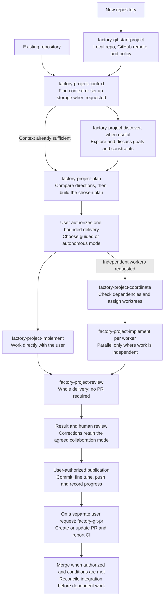

# Development workflow

Skills describe procedures; roles assign responsibility; sessions provide the
execution context. The main session can plan with the user or coordinate work.
An independent implementer has its own interactive session, branch and worktree.
Its reviewer is a fresh native read-only subagent, not another implementation worker.

These diagrams describe the default collaborative workflow, not a mandatory
pipeline. Enter where the task needs it: an existing repo needs no initialization,
useful context needs no repeated discovery, and a small clear fix needs no formal
plan. Explicit user scope and project instructions take precedence.

## From an idea to a delivery



The context and plan live either in `.agent-context/` (local/excluded or versioned)
or in the associated Linear project. The selected location is authoritative;
there is no automatic mirror. Local plans keep design, tasks and the current
checkpoint together. In Linear, the plan document holds design and delivery issues
hold task progress. Storage choice does not change human review boundaries.
Discovery preserves substantive learning during the conversation: short orientation
and links in context, detailed findings in maintained topic research notes. Plans
reuse those notes; agents read relevant links rather than the entire knowledge base.

Discussion may end with more research, a decision to wait, or no new plan.
Planning does not authorize implementation, and completing one delivery does not
authorize starting the next. Parallel workers still return bounded results for
sequential human review and integration.

## Inside an independent implementation

```mermaid
sequenceDiagram
    actor U as User
    participant O as Orchestrator
    participant I as Implementer
    participant R as Reviewer
    participant L as Linear issue

    U->>O: Authorize selected delivery and collaboration mode
    O->>I: Assign scope, context, base, worktree and checks
    opt Guided mode
        loop Each agreed code block
            I->>U: Explain/apply block, show checks and discuss
            U->>I: Feedback and go-ahead for the next block
        end
    end
    opt Consequential uncertainty during implementation
        I->>O: Question, evidence, alternatives and recommendation
        opt Scope, product or unresolved API decision
            O->>U: Explain the decision needed
            U->>O: Resolve the choice
        end
        O->>I: Bounded answer; user checkpoints still apply
    end
    I->>R: factory-project-review: pinned cumulative diff, plan and constraints
    R-->>I: Findings or explicit clean result; verification limits
    I->>U: Review outcome and proposed corrections, if any
    Note over U,I: Guided fixes retain user checkpoints; autonomous fixes stay within scope
    opt Supported findings to fix
        I->>I: Apply agreed corrections and run relevant checks
    end
    opt Corrections or finding dispositions need verification
        I->>R: One focused follow-up with dispositions and correction diff
        R-->>I: Resolved, unresolved and unverified findings
    end
    I-->>O: ready: delivery summary, review target and remaining findings
    I->>U: Final result for validation; request commit/push unless already authorized
    U->>I: Validate work and authorize publication
    I->>I: factory-git-commit: commit, factory-git-post-commit, checks and verified push
    opt Linear-backed delivery
        I->>L: Update published task progress/state and one comment
        L-->>I: Read back and verify saved result
    end
    I-->>O: published: commits, checks, review summary and Linear outcome
    Note over U,O: PR creation and merge remain separate user-requested actions
```

Questions can arise at any point, not just after the guided blocks shown above.
Routine uncertainties are resolved by the implementer using code and context.
The orchestrator handles consequential technical questions within scope and brings
unresolved choices to the user. The user can enter the worker directly; decisions
affecting other workers are reported back to the orchestrator.

In autonomous mode, the implementer completes its assigned delivery without a
checkpoint for every block. Final human review, scope boundaries and explicit Git
authorization still apply. YOLO controls command permissions independently of
guided/autonomous collaboration; it does not approve code or publication.

The full review permits one pass and at most one focused follow-up. Remaining
defects or disagreements are reported rather than triggering an endless loop.
The reviewer writes neither code nor external comments; the implementer evaluates
findings and owns corrections. Neither reviewer opinion nor `ready` means the
user accepted the delivery. The orchestrator receives summaries, not routine logs.

## Publication and checkpoints

Before implementation, agree the [delivery destinations and closure policy](../skills/factory-project-implement/references/delivery-contract.md).
Work branches, combined integration and upstream PR targets may differ. Code,
docs and examples each have an intended delivery/PR or an explicit local-only use.
A user may authorize commit/review/push and issue updates once for named deliveries,
triggered by acceptance; workers receive and reuse that agreement. Guided mode and
YOLO do not imply it. PRs and merges still require their own explicit authorization.
Report verification, review, acceptance, push, issue update and PR state separately;
reconcile delivery-owned leftovers before claiming closure, preserving unrelated work.

- `factory-project-review` examines the cumulative delivery, even with uncommitted changes.
  `factory-git-post-commit` checks and fine-tunes the specific commits just created; it is
  not another full feature review. Both report their actual outcome.
- The user may authorize intermediate commits and pushes before the delivery is
  finished. Those run the Git workflow without triggering a full review after
  each block. The later delivery review includes their cumulative effect.
- Successful publication updates only the reviewed, published work in Linear.
  Partial deliveries remain in progress. A pushed branch is not automatically
  done if the team's workflow still requires a PR, review or merge.
- Local-only requests and failed pushes leave Linear progress unchanged. A failed
  Linear update is reported separately from a successful push, without duplicate
  comments on retry. One designated writer updates each issue.
- The orchestrator owns shared context/plan documents and integration. Implementers
  obtain Git permission directly from the user and update their assigned issues;
  they do not ask the orchestrator to approve routine publication.
- Changes after a review must not be presented as already reviewed. Report stale
  coverage and verify integration against the actual target branch.

## Source instructions

The diagrams summarize these maintained procedures; they do not replace them:

| Responsibility | Skill |
| --- | --- |
| Repository and GitHub setup | [factory-git-start-project](../skills/factory-git-start-project/SKILL.md) |
| Context location and setup | [factory-project-context](../skills/factory-project-context/SKILL.md) |
| Onboarding and shared understanding | [factory-project-discover](../skills/factory-project-discover/SKILL.md) |
| Direction, technical approach and delivery plan | [factory-project-plan](../skills/factory-project-plan/SKILL.md) |
| Independent worker assignments and integration | [factory-project-coordinate](../skills/factory-project-coordinate/SKILL.md) |
| Existing delivery sources and progress checkpoints | [factory-project-delivery](../skills/factory-project-delivery/SKILL.md) |
| Guided or autonomous implementation | [factory-project-implement](../skills/factory-project-implement/SKILL.md) |
| Independent delivery review | [factory-project-review](../skills/factory-project-review/SKILL.md) |
| Authorized commit and push | [factory-git-commit](../skills/factory-git-commit/SKILL.md) |
| Bounded commit fine tuning | [factory-git-post-commit](../skills/factory-git-post-commit/SKILL.md) |
| Requested PR creation/update and CI reporting | [factory-git-pr](../skills/factory-git-pr/SKILL.md) |

Worker model and reasoning preferences are configured by role in the machine-local
config; see [the example](../config.example.json). The orchestrator uses the model
selected by the user. Editor and terminal preferences remain outside this
development lifecycle.

## Loading instructions by stage

Skill entrypoints retain scope, source authority and human checkpoints. Read only
the references whose trigger matches the current operation; links are navigation,
not a request to recursively load every dependency. Reuse applicable instructions
already read in the session.

- Discovery reads existing context before loading persistence guidance.
- Planning discusses direction before loading plan-writing formats. Revisions
  load their procedure when an existing agreement changes.
- Coordination separates preparing/launching workers from handling their events.
- Implementation loads the selected mode, then delegation, handoff or publication
  instructions only at those boundaries.
- Context lookup and delivery loading do not load Linear mutation procedures.
- Review distinguishes the caller's setup from the delegated reviewer's job.

Keep short, sequential Git workflows together: all their steps are needed for the
requested operation. Splitting files is useful only when a real execution path
can omit them. Preserve essential constraints in the entrypoint even when detailed
procedures move. Evaluate complete reading paths and behavior, not file length
alone; more references do not guarantee a smaller context.
